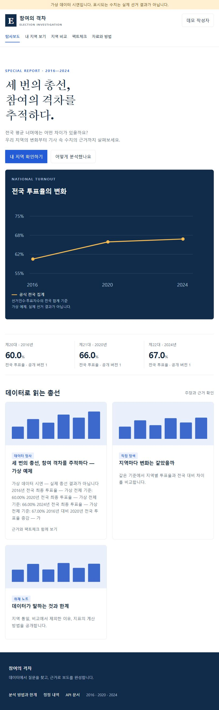

# 참여의 격차 · Election Analysis App

2016·2020·2024년 총선의 지역별 투표 참여 격차를 분석하고, 기사 속 수치에서 원본까지 추적하는 **실행 가능한 초기 구현(v0.1.0)**입니다.

독자 화면과 취재 관리 화면, FastAPI 백엔드, 31개 업무 테이블, 별도 비동기 Worker, 팩트체크·독립 승인·공개/철회 흐름을 포함합니다. 설계한 66개 API 경로를 등록했으며 초기 지원 범위와 설계 대비 차이는 [구현 범위](docs/IMPLEMENTATION.md)에 명시했습니다.

**제공하는 CSV와 화면 예시는 모두 가상 데이터이며 실제 선거 결과가 아닙니다.** 실제 보도 전에는 공식 원본 수집, 지역 경계 대응 검토, 독립 재계산과 사람 승인이 필요합니다. 외부 생성 모델·OIDC 인증·클라우드 저장소는 아직 연결하지 않았습니다.



## 바로 실행

Python 3.12 이상을 사용합니다. Node 설치나 프론트엔드 빌드가 필요하지 않습니다.

```sh
git clone https://github.com/sinyoungk0711-droid/Election_Analysis_App.git
cd Election_Analysis_App
python -m venv .venv
```

Windows PowerShell:

```powershell
.\.venv\Scripts\python.exe -m pip install -r requirements.txt
.\.venv\Scripts\python.exe -m app.cli demo
$env:APP_DEMO_MODE="1"
.\.venv\Scripts\python.exe -m uvicorn app.main:app --host 127.0.0.1 --port 8000
```

macOS / Linux:

```sh
.venv/bin/python -m pip install -r requirements.txt
.venv/bin/python -m app.cli demo
APP_DEMO_MODE=1 .venv/bin/python -m uvicorn app.main:app --host 127.0.0.1 --port 8000
```

두 번째 터미널에서 같은 폴더·같은 환경 설정으로 Worker를 실행합니다.

```powershell
# Windows
.\.venv\Scripts\python.exe -m app.worker
```

```sh
# macOS / Linux
.venv/bin/python -m app.worker
```

[http://127.0.0.1:8000](http://127.0.0.1:8000)에서 독자 화면을, [API 문서](http://127.0.0.1:8000/docs)에서 실제 요청 모델을 확인합니다. `취재 관리`에서 데모 작성자·검증자·총괄을 선택할 수 있습니다. 데모 토큰은 생성 후 12시간 유효합니다. 실제 인증정보는 저장소에 포함하지 않습니다.

`demo`는 비어 있는 DB에서만 실행합니다. 새 시연이 필요하면 다른 `APP_DATA_DIR`을 지정하세요. 데모 모드는 로컬 시연 전용이며 외부 공개 서버에서 사용하면 안 됩니다.

## 실제 자료로 시작하기

데모 없이 `python -m app.cli init`으로 선거·지표·FC01~FC20만 초기화합니다. CLI와 웹 서버·Worker가 같은 `APP_DATA_DIR`과 `DATABASE_URL`을 사용해야 합니다.

```sh
python -m app.cli init
python -m app.cli create-user --name writer --roles ANALYST,SEARCHER,EDITOR
python -m app.cli create-user --name reviewer --roles REVIEWER
python -m app.cli create-user --name lead --roles LEAD
```

각 명령에서 한 번 표시되는 토큰을 해당 사용자에게 전달합니다. 재발급은 `python -m app.cli issue-token --name writer`입니다. 역할을 겸임해도 자기 작성·검증 결과는 승인할 수 없습니다. 최종 승인자 역시 독립 사용자여야 합니다.

1. 데이터 화면에서 출처·기관·이용 조건과 UTF-8 CSV를 등록합니다.
2. 가져오기 완료 후 품질 검사를 실행합니다.
3. 독립 검토자가 데이터 기준본을 승인하고 작성자가 고정합니다.
4. 분석을 실행하고 독립 검토자가 결과를 확인·승인합니다.
5. 도표와 기사 초안을 작성하고 개정본을 저장합니다.
6. 문장별 수치·출처 검사, FC01~FC20 검증, 다른 사람의 승인, 기사 승인을 진행합니다.
7. 리포트와 뉴스저널을 업로드·검수하고 묶음 고정 → 독립 총괄 승인 → 공개를 진행합니다.

수치·주장·근거 수정은 새 버전으로 생성합니다. 공개 중인 승인 철회는 영향받는 공개 묶음을 함께 철회합니다.

## CSV 형식

[data/sample_turnout.csv](data/sample_turnout.csv)는 가상 예제입니다.

```csv
election_year,province,region_code,region_name,eligible_voters,voters,official_turnout
2016,가상도,DEMO-1,가상1시,100000,60000,60.0
2016,,NATIONAL,가상 전국,300000,180000,60.0
```

지역 코드는 세 선거에서 같은 경계를 나타내는 통일 코드여야 합니다. 경계 변경을 자동으로 추정하지 않습니다. 세 선거 각각 `NATIONAL` 전국 공식 합계 행 1개가 필요하며 지역 평균을 전국 투표율로 사용하지 않습니다. 비교 지역은 세 선거 관측이 모두 있는 지역이며, 제외 사유를 보존합니다. 빈 값·중복·범위 오류는 임의 보정하지 않고 실패 처리합니다. 공식 값과 재계산 값은 별도로 보존합니다.

## PostgreSQL와 컨테이너

기본은 SQLite이며 개발·시연 용도입니다. `DATABASE_URL=postgresql+psycopg://...`로 PostgreSQL을 사용할 수 있습니다. DB 테이블과 보호 트리거는 최초 기동 시 생성합니다. 기존 운영 스키마의 자동 변경·마이그레이션은 포함하지 않습니다.

```sh
# .env에 URL 안전한 임의의 비밀번호를 설정
# POSTGRES_PASSWORD=...
docker compose up --build -d
docker compose exec api python -m app.cli init
docker compose exec api python -m app.cli create-user --name writer --roles ANALYST,SEARCHER,EDITOR
```

컨테이너 API는 `127.0.0.1:8000`에만 노출하고 데모 모드는 꺼져 있습니다. 외부 서비스 전에는 TLS 프록시, 인증 연계, 비밀값 관리, DB·파일 백업, 복원·부하·보안 검수를 적용해야 합니다. Docker/PostgreSQL 구성은 제공하지만 로컬 환경에서 컨테이너 실행 검증은 수행하지 않았습니다. CI에 PostgreSQL 연결 검사를 구성했습니다.

## 테스트와 설계 자료

```sh
python -m pip install -r requirements-dev.txt
python -m pytest -q
python scripts/export_contracts.py
```

- [구현 범위와 설계 대비 차이](docs/IMPLEMENTATION.md)
- [실행·운영·검수 안내](docs/OPERATIONS.md)
- [시스템 구조](docs/ARCHITECTURE.md)
- [실제 OpenAPI 계약](docs/openapi.json)
- [실제 PostgreSQL DDL](docs/schema.postgresql.sql)
- [API 목록](docs/endpoints.md)

테스트는 인증·권한, 중복 요청, ETag 충돌, CSV 원자 처리, 계산, 승인·공개·철회, 근거 추적, 커서, DB 제약과 66개 API 등록을 확인합니다. PostgreSQL 연동 시험은 `TEST_DATABASE_URL`이 있을 때 실행됩니다. 브라우저에서는 홈·지역 선택·관리자 로그인·기사 조회·팩트체크·결과 행 연결을 확인했습니다.
