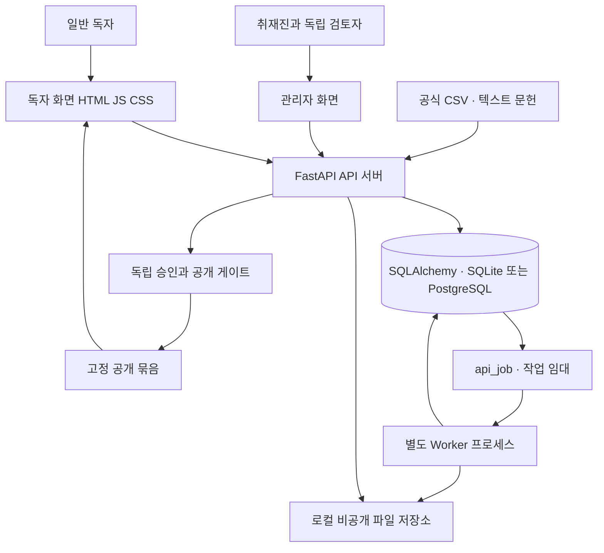

# 구현된 시스템 구조

백엔드는 모듈형 단일 서비스, Worker는 별도 프로세스입니다. 각 HTTP 요청은 트랜잭션으로 처리합니다. SQLite에서는 `BEGIN IMMEDIATE`, PostgreSQL에서는 공통 트랜잭션 잠금으로 쓰기 경합을 보수적으로 직렬화합니다. 현재 구현은 소규모 취재 작업실 기준이며 고부하용 분산 구조가 아닙니다.

## 데이터와 근거

31개 업무 테이블은 검토한 데이터 사전에서 생성합니다. 운영용 토큰·작업·멱등·스키마 버전 테이블을 추가합니다. PK·FK·복합 UQ·관측 범위·근거 XOR·공개 항목 XOR를 DB에서 검사합니다. 불변 버전의 UPDATE/DELETE와 고정 데이터·공개 묶음 하위 데이터 수정을 트리거로 차단합니다. 승인 독립성·지표·기사·파일의 교차 조건은 서버 업무 계층이 검사합니다.

추적 경로: 공개 묶음 → 기사 개정본 → 주장 → 문헌 근거 또는 분석 결과 → 실행·지표·데이터 버전 → 원본 매핑·파일 해시.

## 비동기 작업

DB 큐는 QUEUED → RUNNING → SUCCEEDED/FAILED로 전이합니다. Worker 임대 만료 시 재처리할 수 있으며 최대 3회 임대 후 종료합니다. 현재 작업은 5분 임대, 단일 짧은 반영 트랜잭션입니다. 장시간 외부 모델 호출·하트비트 연장·별도 메시지 브로커는 후속 운영 확장 항목입니다.

## 외부 연계 범위

현재 실행 경로는 외부 인증·모델 API·클라우드 저장소를 호출하지 않습니다. 대신 CLI 발급 12시간 토큰, 규칙 기반 분석 초안, 로컬 파일 저장소를 사용합니다. OIDC·LLM·벡터 검색·오브젝트 저장소 어댑터는 설계상 연결 위치만 유지합니다.
